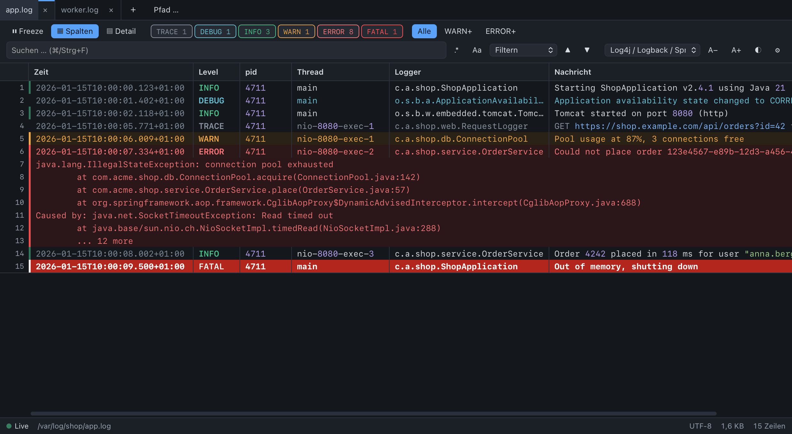
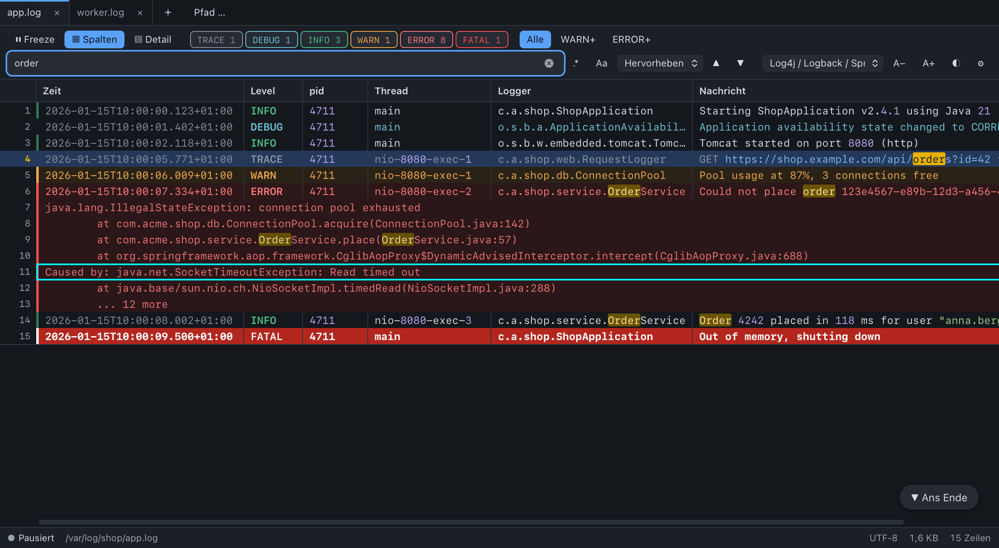
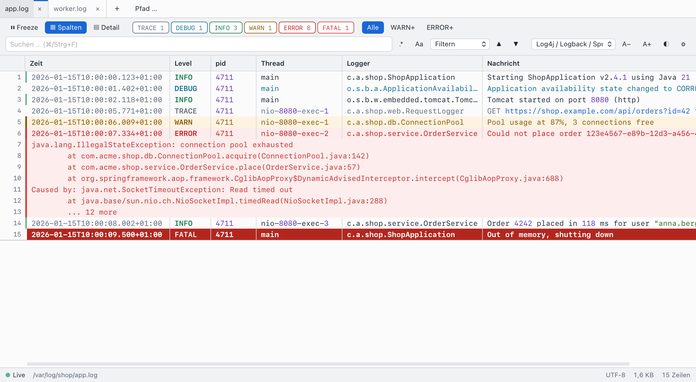
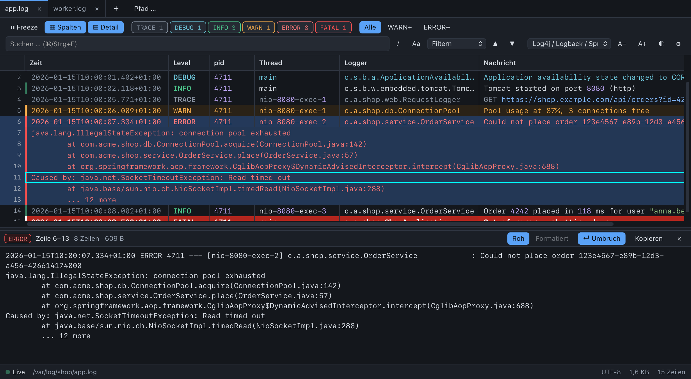

<p align="center"></p>

<h1 align="center">Log Commander</h1>

<p align="center"><b>A fast, colourful live log viewer for macOS, Windows and Linux.</b><br>
Like <code>tail -f</code> with a GUI: millions of lines, instant filters, no waiting.</p>



## Features

- **Live tail** – new lines appear at once. Detects truncation (`> app.log`), rotation (`app.log` → `app.log.1`), and a
  file that disappears and comes back. Never blocks the writing process.
- **Huge files** – the Rust backend keeps an index, not the text. 500 MB and 5 million lines: first lines after 25 ms,
  fully indexed in about 2 seconds, 78 MB of index ([measurements](#performance)).
- **Levels and colours** – TRACE, DEBUG, INFO, WARN, ERROR, FATAL, with chips that count live. Click toggles,
  Alt-click shows only this level, double click shows this level and worse. Presets `WARN+` and `ERROR+`.
- **Stack traces stay together** – continuation lines inherit the level of their entry, and filtering and selecting
  treat the entry as a unit.
- **Formats** – detected from the first lines: Log4j/Logback/Spring Boot, Python `logging`, Serilog, syslog,
  nginx/Apache error logs, JSON Lines (including numeric Pino/Bunyan levels), Common/Combined access logs, W3C/IIS,
  NLog, Java GC (unified logging), FIX, logfmt. Add your own regex with `(?P<level>...)`.
- **Fields** – each line is split into fields such as time, thread, level, logger and message, without defining a
  format. JSON and logfmt keys and FIX tags become fields; an unknown format is inferred (delimiters or timestamp,
  level, `[thread]`, `logger:`), otherwise the line stays one message. The profile tooltip shows how well the format
  fits ("Log4j · 97 %"); custom profiles take layouts (regexes with named groups) with a live preview.
- **Columns** – a recognised format is shown as a table with a header: one column per field, stack traces run
  across the full width. Drag a column edge to resize it (double click fits it to the rows on screen), drag a title
  to move it; right click on the header or `Shift+F10` opens a menu to show, hide, move and resize columns or reset
  them. The layout is remembered per format. `T` or the toolbar switch goes back to the raw lines. No sorting: the
  view stays in file order.
- **Detail panel** – the whole entry of the selected line below the log: head line and stack trace, without the
  cut at the screen edge and whatever the filter hides. Embedded JSON or XML is indented and coloured by its own
  tokenizer, so 64-bit ids stay exact and fragments work. Double click a line (or `D`) to open it, click other lines
  to browse, drag or use the arrow keys on the bar above it to change its height.
- **Search** – filter or highlight, regular expressions, case sensitivity, jump between matches.
- **Follow** – stays at the end while you are there; scroll up and it pauses and counts the new lines.
- **Freeze** – holds a tab to read in peace: lines, counts and the position stay put while filters and search keep
  working. Resuming reads everything written in between.
- **Comfort** – tabs with a red dot for new errors in the background, drag & drop, command line, recent files,
  copying whole entries, dark and light themes that follow the system, adjustable colours.
- **Encodings** – UTF-8, UTF-16 by BOM, Latin-1 detection; invalid bytes never stop it. ANSI colours in logs are removed.

| | |
|---|---|
|  |  |
|  | |

## Install

Packages for each platform are built by the [release workflow](.github/workflows/release.yml) (unsigned until the signing
secrets are set; see the comments there).

## Usage

```bash
log-commander /var/log/app.log /var/log/other.log
```

| Key | Action |
|---|---|
| `Cmd/Ctrl+O` | Open a file |
| `Cmd/Ctrl+Shift+O` | Type or paste a path to open (`~` works) |
| `End`, `F` | Go to the end and follow |
| `Space` | Pause or resume following |
| `P` | Freeze: hold or resume reading the file of this tab |
| `T` | Columns or raw lines |
| `D`, double click on a line | Detail panel with the whole entry; in it the arrows scroll the panel |
| `↑`, `↓` on the panel's bar | Panel height (`Shift`: bigger steps, `Home`/`End`, double click: default) |
| `Shift+F10` | Column menu (show, hide, move, resize, reset) |
| `Home`, `PageUp`, `PageDown`, `↑`, `↓` | Move through the file |
| `Cmd/Ctrl+F` | Search; `Enter` next match, `Shift+Enter` previous, `Esc` clear |
| Click, `Shift`+click | Select an entry, or a range (an open detail panel follows) |
| `Cmd/Ctrl+C` | Copy the selected lines |
| `Cmd/Ctrl+W`, `Ctrl+Tab` | Close a tab, next tab |
| `Cmd/Ctrl+,` | Settings |

## Development

Requires Node ≥ 22, Rust stable and the [Tauri prerequisites](https://tauri.app/start/prerequisites/).

```bash
npm install
```

```bash
npm run tauri:dev
```

(`cargo tauri dev` works too, once `cargo install tauri-cli` is done.) `npm run check` runs everything except the
end-to-end test; `npm run e2e` runs the real app with a real log file. Details: [CLAUDE.md](CLAUDE.md).

Try it with live data:

```bash
npm run demo:log     # writes /tmp/app.log, stop with Ctrl+C
npm run demo:app     # in a second terminal: the app with that file
npm run demo:clean   # removes the files afterwards (macOS, Linux)
```

For other data use `npm run gen-log -- /tmp/app.log` with `--rate N`, `--format spring|python|json|nginx`,
`--rotate-every N`, `--truncate-every N`, `--lines N`, `--stack 0..1`. Example files are in [`samples/`](samples/).

## Performance

Measured on an Apple Silicon Mac, release build, with
`cargo test --release --test tail_integration -- --ignored --nocapture measure_` (500 MB, 5.1 million lines):

| | |
|---|---|
| First lines | 25 ms |
| Fully indexed | 2.2 s |
| Index in RAM | 78 MB |
| Level filter over all lines | 15 ms |
| Full text search over all lines | 0.7 s |
| `get_lines`, 200 lines at a random position | 43 µs |

At 10,000 lines per second the UI's event loop was never blocked for more than 8 ms (debug build, `npm run e2e`).

## License

[MIT](LICENSE) © Marc Kronberg
