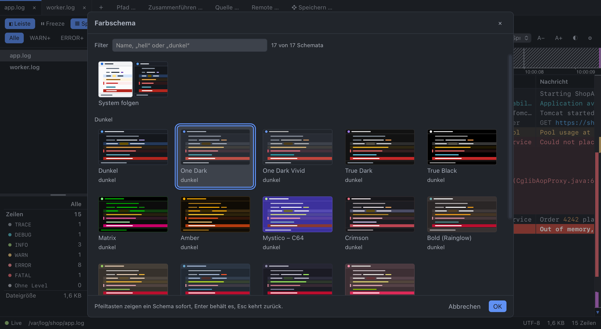

# Farben und Farbschemata

Log Commander hat **17 Farbschemata**: die Basis **dark** und **light** und 15 Schemata nach bekannten Editor-Themes
(Prompt 020). Man wählt sie in einer Galerie mit Vorschaubildern („◐“ in der Toolbar, Ansicht ▸ Colour Scheme…,
`Cmd/Ctrl+Alt+T`, Einstellungen ▸ „Farbschema wählen …“). Die Level-Farben lassen sich zusätzlich in den
Einstellungen anpassen, sie liegen über jedem Schema. Alle Farben sind Design-Tokens; Komponenten verwenden nur
`var(--…)`, nie feste Farbwerte.



## Aufbau

```css
/* src/styles.css */
/* @theme dark */
:root { --bg-app: #14171c; … }
/* @end */

/* @theme light */
:root[data-theme='light'] { --bg-app: #fbfbfc; … }
/* @end */

:root { --font-ui: …; --font-mono: …; --radius: 5px; }   /* ohne Farbe, gilt für beide */
```

- **`src/styles.css` ist die Quelle für dark und light.** dark ist der Grundwert auf `:root`, light überschreibt ihn über
  `data-theme='light'`. Jeder Farb-Token steht in **beiden** Blöcken als sechsstelliger Hex-Wert.
- **Alle anderen Schemata** liegen als JSON in `src/app/core/theme/themes/<id>.json` (`{ id, name, dark, tokens }`)
  und enthalten nur, was von der Basis ihrer Helligkeit abweicht. Ein vergessener Token ist also nie leer.
- `themes/dark.json` und `themes/light.json` sind die Basis als Werte fürs Frontend (Vorschaubilder, Prüfung). Sie werden
  nicht von Hand gepflegt: `npm run contrast -- --write-base` schreibt sie aus `styles.css`, `npm run contrast` bricht ab,
  wenn sie abweichen.
- **Katalog** `src/app/core/theme/tokens.ts`: jeder Token mit Gruppe, deutschem Namen und Art (`color`, `font`). Die
  Farb-Tokens sind genau die der `@theme`-Blöcke (Test). `--font-ui` und `--font-mono` darf ein Schema ändern (Matrix und
  Amber: Monospace überall).
- Die GuiExpert Table der Log-Ansicht bekommt ihre Farben über `--ge-table-*` in `log-table-view.css`, und zwar nur als
  `var(--token)` oder `transparent` (Test in `scripts/theme-from-fnf.test.mjs`). Sie folgt damit jedem Schema; die
  eigene CSS der Tabelle ist nicht eingebunden.

## Auswahl und Anwendung

Einstellung `themeSelection` = `{ mode: 'system' | 'fixed', theme, light, dark }` (Vorgabe: System folgen mit light und
dark). „System folgen“ nimmt je ein wählbares helles und dunkles Schema. Die alte Einstellung `theme`
(`system`/`dark`/`light`) wird in `mergeSettings` übernommen: `system` → System folgen, `dark`/`light` → fest.

Der `ThemeService` (`core/theme/theme.service.ts`) bringt das Schema auf den Bildschirm:

- `data-theme` und `color-scheme` auf `<html>` nach `dark` des Schemas, `meta theme-color` = `--bg-app`.
- Die Tokens des Schemas (nur Abweichungen, nur Katalog-Tokens mit gültigem Wert) inline per `style.setProperty`;
  was das vorige Schema gesetzt hat und das neue nicht, wird entfernt. dark und light setzen nichts inline.
- Darüber die eigenen Level-Farben (`colorOverrides`), auch in der Vorschau des Pickers.
- **Fensterrahmen:** Command `set_window_chrome(color, dark)` setzt Hintergrund (`--bg-app`, nur `#rrggbb`) und
  Erscheinungsbild des Fensters. Beim festen Schema wird das Erscheinungsbild erzwungen, bei „System folgen“ bleibt es
  beim System (`dark = null`): Es bestimmt unter macOS auch `prefers-color-scheme` der WebView, ein erzwungenes würde dem
  System nicht mehr folgen.
- **Start ohne Blitz:** Das Fenster startet unsichtbar (`"visible": false`), der erste `set_window_chrome` nach dem Laden
  der Einstellungen zeigt es, spätestens nach 1 s zeigt Rust es von selbst. `tauri-plugin-window-state` stellt
  „sichtbar“ deshalb nicht wieder her.
- **Laden bei Bedarf:** Die Schemata sind ein eigener Chunk (~33 KB), der Startbundle kennt nur ihre Ids und Helligkeit
  (`BUILT_IN_DARK` in `theme.models.ts`, Test gegen die Dateien). dark und light brauchen nichts zu laden.
- Canvas-Teile (Overview Ruler, Zeitstrahl, Dashboard) lesen Farben per `getComputedStyle` und zeichnen über einen
  `MutationObserver` auf `data-theme` und `style` von `<html>` neu. Jede Änderung oben, auch die Vorschau, berührt eins
  davon.

### Picker

`features/themes/theme-picker.ts`: Raster aus Karten (`listbox` mit `aria-activedescendant`), „System folgen“ zuerst
(geteiltes Bild aus hellem und dunklem Schema, darunter zwei Auswahlfelder), dann die dunklen, dann die hellen Schemata.
Filter nach Wörtern im Namen und „hell“/„dunkel“, Zähler als `role="status"`. Pfeiltasten und Zeiger zeigen ein Schema
sofort (Vorschau), `Enter`/OK behält es, `Esc`/Abbrechen/× kehren zurück. Pfeil hoch aus der ersten Reihe geht ins
Filterfeld, Tippen im Raster filtert. Sind eigene Level-Farben aktiv, sagt ein Hinweis, dass sie über jedem Schema
liegen. Die Vorschaubilder (`theme-thumb.ts`) zeichnen ein Mini-Log nur aus den Tokens: Toolbar-Streifen, Gutter,
TRACE, INFO mit Zeit und Zahl, eine gewählte Zeile mit Treffer, WARN, ERROR mit Rand, DEBUG, FATAL und die Statusleiste.
Nur aufgelöste `#rrggbb` gelangen als `--thumb-*` in den Stil der Karte.

## Tokens

| Gruppe | Tokens | Wofür |
|---|---|---|
| Flächen | `--bg-app`, `--bg-panel`, `--bg-raised`, `--bg-hover`, `--bg-gutter`, `--border` | Fenster, Leisten, Menüs, Hover, Zeilennummern, Linien |
| Text | `--text`, `--text-dim` | Normaler und gedämpfter Text |
| Akzent und Status | `--accent`, `--accent-text`, `--danger`, `--ok` | Fokus, aktive Elemente, Primär-Button, Fehler, Erfolg |
| Auswahl und Treffer | `--row-selected`, `--hit-bg`, `--hit-text`, `--hit-current-bg`, `--hit-current-text` | Gewählter Eintrag, Suchtreffer, aktueller Treffer |
| Level | `--lv-<level>-fg`, `--lv-<level>-bg` für `trace`, `debug`, `info`, `warn`, `error`, `fatal`, `unknown`; dazu `--lv-info-badge`, `--lv-error-edge` | Zeilenfarbe je Level, Markierung am Zeilenrand |
| Inline-Tokens | `--tok-time`, `--tok-number`, `--tok-string`, `--tok-id`, `--tok-url` | Hervorhebung in der Zeile (`highlight.ts`), JSON/XML im Detail-Panel |
| Splitter | `--splitter-bg`, `--splitter-grip`, `--splitter-hover-bg` | Leiste, Griff in der Mitte, Hover/Ziehen (`shared/splitter.ts`) |
| Quellen (Merge) | `--src-1` … `--src-8`, Klasse `src-N` setzt `--src` | Streifen im Zeilenrand, Chips, Dialog, Baum und Statistik (Prompt 006) |
| Overview Ruler | `--ruler-bg`, `--ruler-band`, `--ruler-band-edge`, `--ruler-fatal`, `--ruler-error`, `--ruler-warn`, `--ruler-bookmark`, `--ruler-selection` | Leiste rechts (Prompt 007) |
| Notizen | `--note` | Stift im Gutter, Raute im Ruler, Symbol im Detail-Panel (Prompt 015) |
| Zeitstrahl | `--tl-all`, `--tl-gap` (dazu Ruler-Tokens, `--accent`, `--text-dim`) | Streifen über dem Log (Prompt 014) |
| Dashboard | `--chart-1` … `--chart-8`, `--chart-lv-<level>`, `--chart-grid` | Reihen, Reihen je Level, Gitterlinien (Prompt 012) |
| Schrift | `--font-ui`, `--font-mono` | Je Schema änderbar (nur Familiennamen) |

Alle Zellen einer Zeile tragen die Klasse `lv-<LEVEL>` (`table-logic.ts`), `log-table-view.css` setzt daraus Vorder- und
Hintergrund. FATAL ist als einziges Level eine kräftige Fläche, ERROR und WARN haben eine getönte Fläche und ERROR eine
Markierung am Rand. Filter-Tabs (Prompt 013), Kopfzeile und Spaltenmenü (009), Detail-Panel (004) und Seitenleiste (005)
nutzen vorhandene Tokens.

## Kontrast (WCAG AA)

Die Paare stehen in **einer** Datei: `src/app/core/theme/contrast-pairs.json`, je Paar `[Vordergrund, Hintergrund,
Schwelle]` – 32 Textpaare mit 4,5:1 und 83 Grafikpaare mit 3:1 (WCAG 1.4.11). Seit Prompt 020 neu: `--accent` auf
`--bg-panel` und `--lv-error-edge` auf `--lv-error-bg` (beide 3:1).

- `npm run contrast` (`scripts/check-contrast.mjs`, erster Schritt von `npm run check`) prüft dark und light aus
  `styles.css` und **jedes** Schema in `themes/`, ergänzt aus seiner Basis. Die Ausgabe nennt Schema, Paar und Wert
  (`matrix: --text-dim on --bg-panel = 3.80 (below 4.5)`). Außerdem: dark/light gleich `styles.css`, nur Katalog-Tokens,
  Farben nur als `#rrggbb` oder `var(--token)`. `--dir <ordner>` prüft einen anderen Ordner (Test mit dem absichtlich
  schlechten Schema in `scripts/fixtures/bad-scheme/`).
- Dieselbe Prüfung läuft als Vitest (`builtin-themes.spec.ts`) über `checkContrast` aus `theme-logic.ts`, die auch ein
  späterer Editor und Import nutzen.
- Inhalt der Paare: alle Level-Paare, Text auf Flächen und Auswahl, Treffer, Inline-Tokens auf dem Log und im
  Detail-Panel, `--accent-text` auf `--accent`, `--danger` auf `--bg-panel`, Achsentext des Zeitstrahls; als Grafik der
  Griff der Splitter, Level-Punkte der Statistik, Quellfarben gegen Gutter, Auswahl, Panel und Menüs, alle Marken des
  Ruler gegen Fläche und Band, Säulen und Ausfall des Zeitstrahls, Notizen, Reihen des Dashboards. Gitterlinien
  (`--chart-grid`) sind Zierde und werden nicht geprüft.
- Wird ein neues Vordergrund/Hintergrund-Paar gebraucht, gehört es in `contrast-pairs.json`. Ein Token ohne Paar wird
  nicht geprüft.
- Farbe ist nie die einzige Information: Level steht als Wort in der Zeile, Quellen mit Namen, Zustände mit Text oder
  Symbol, Dashboard-Reihen in der Legende.
- Schemata erfüllen den Kontrast **ohne Korrektur zur Laufzeit**. Wo eine Farbe des Originals zu schwach ist, wurde sie
  einmal beim Erzeugen angepasst (siehe unten).

## Eigene Level-Farben

In den Einstellungen lassen sich die Tokens aus `COLOR_TOKENS` (`settings.models.ts`) überschreiben: Text, Hintergrund,
Badge und Rand der Level. Gespeichert wird `colorOverrides` (Token-Name ohne `--` → Farbe), der `ThemeService` setzt sie
über das Schema.

- Nur Tokens mit Präfix `lv-` und nur reine Farben (`#hex`, `rgb()`, `hsl()`); alles andere verwirft schon
  `mergeSettings`.
- Overrides gelten für **jedes** Schema und werden nicht auf Kontrast geprüft, es ist die Wahl des Nutzers. Der Picker
  weist darauf hin, wenn welche aktiv sind.
- „Farben zurücksetzen“ leert `colorOverrides`, danach gelten wieder die Werte des Schemas.

## Werte sind Nutzereingaben

Was per `setProperty` in den Stil gelangt, geht durch `tokenValueOk` (`theme-logic.ts`): nur Katalog-Tokens; Farben nur
als `#hex`, `rgb()`/`rgba()`, `hsl()`/`hsla()` mit Zahlen oder `var(--…)` auf einen Katalog-Farb-Token ohne Fallback;
Schriften nur als Liste von Familiennamen. Abgelehnt werden u. a. `url(`, `expression(`, `image(`, `attr(`, `env(`,
`;`, `{`, `}`, `<`, `>`, `\`, `@`, Steuerzeichen und Werte über 200 Zeichen. Specs mit bösartigen Werten in
`theme-logic.spec.ts`. Für die eingebauten Schemata ist das doppelt, für einen künftigen Import Pflicht.

## Eingebaute Schemata, Herkunft und Lizenz

Die Schemata entstehen aus den Schemata von files-and-folders (gleicher Autor, MIT), die wiederum Editor-Themes
nachbilden. Übernommen werden **nur Farbwerte**, keine Dateien der Originale im Build. Farbwerte sind kein schützbares
Werk; die Herkunft steht hier aus Höflichkeit.

| Id | Name | Original | Lizenz des Originals |
|---|---|---|---|
| `one-dark` | One Dark | JetBrains-Plugin „One Dark theme“ von Mark Skelton (nach Atom One Dark) | MIT |
| `one-dark-vivid` | One Dark Vivid | dasselbe, Variante „Vivid“ | MIT |
| `true-dark` | True Dark | JetBrains-Theme „True Dark“ von Ahmed Elshaer (`ahmed3elshaer/IntelliJ-True-Black-Theme`) | MIT |
| `true-black` | True Black | dasselbe, „True Black“ | MIT |
| `true-light` | True Light | dasselbe, „True Light“ | MIT |
| `matrix` | Matrix | eigenes Schema von files-and-folders nach einem Screenshot eines grünen VS-Code-Themes | – |
| `amber` | Amber | Schema „Amber“ aus Marcs Editor *editlicious* (Bernstein-Monitor) | MIT |
| `solarized-light` | Solarized Light | VS Code „Solarized (light)“ (`microsoft/vscode`), Palette von Ethan Schoonover | MIT |
| `mystico-c64` | Mystico – C64 | VS-Code-Theme „Mystico C64“ von chibanti (`chibanti/mystico-c64-vscode-theme`) | MIT |
| `crimson` | Crimson | eigenes Schema von files-and-folders (nach Kursfolien zu Nest.js) | – |
| `rainglow-bold` | Bold (Rainglow) | Rainglow „bold“ von Dayle Rees (`rainglow/vscode`) | MIT |
| `rainglow-earthsong` | Earthsong (Rainglow) | Rainglow „earthsong“ von Dayle Rees | MIT |
| `rainglow-legacy` | Legacy (Rainglow) | Rainglow „legacy“ von Dayle Rees | MIT |
| `rainglow-heroku` | Heroku (Rainglow) | Rainglow „heroku“ von Dayle Rees | MIT |
| `rainglow-piggy` | Piggy (Rainglow) | Rainglow „piggy“ von Dayle Rees | MIT |

Je Schema ein Bild in `docs/screenshots/schemes/<id>.png` (`node scripts/screenshots.mjs --schemes`).

### So entstehen sie

`scripts/theme-from-fnf.mjs` (Test: `scripts/theme-from-fnf.test.mjs`) arbeitet in zwei Schritten:

1. `node scripts/theme-from-fnf.mjs <fnf-theme.json>` liest ein Schema von files-and-folders und gibt ein **Rezept** aus:
   die Palette aus seinen Tokens (`var()` aufgelöst). Abbildung: Log-Fläche `--bg-app` ← `--color-list-bg` (die
   Inhaltsfläche; `--color-bg` ist dort der Fensterrahmen hinter den Panels), `--bg-panel` ← `--color-surface`,
   `--bg-raised` ← `--color-surface-raised`, `--bg-hover` ← `--color-row-hover`, `--border` ← `--color-border`, `--text`
   ← `--color-list-text`, `--text-dim` ← `--color-muted`, `--accent`/`--accent-text` ← `--color-accent*`,
   `--row-selected` ← `--color-cursor-inactive-bg` (neutral, damit die Level-Farben darauf lesbar bleiben), `--hit-bg`
   ← `--color-search-hit`, Rot ← `--color-error-text`, kräftiges Rot ← `--color-danger`. Level- und Inline-Farben gibt
   es dort nicht; sie kommen aus den Farben der Icons, die die Palette des Originals tragen: Warnung aus Gelb
   (`--color-favorite`), Debug aus Cyan (`--color-symlink-text`), Trace aus dem gedämpften Text, Zahl aus Orange
   (`--color-icon-archive`), String aus Grün (`--color-icon-executable`), ID aus Violett (`--color-icon-image`), URL aus
   Blau (`--color-icon-code`), Zeit aus dem gedämpften Text; Quellen und Dashboard-Reihen aus `--color-usage-1…8`.
2. Die Rezepte stehen in `scripts/theme-recipes.json` und sind von Hand nachbearbeitet (`palette`, optional `set` für
   einzelne Tokens, `fonts: "mono"`). `node scripts/theme-from-fnf.mjs --all [id] [--verbose]` macht daraus alle Tokens
   (getönte Flächen für WARN mit 12 % bzw. 10 %, für ERROR mit 14 % bzw. 8 % der Level-Farbe auf dem Log) und **passt
   einmalig** an: Verfehlt ein Vordergrund sein Paar, wird er schrittweise zu Weiß bzw. Schwarz hin verschoben; ist der
   Vordergrund selbst die Lesefarbe (`--text`, FATAL-Text), bewegt sich stattdessen der Hintergrund. Tokens aus `set`
   bewegen sich nie (dann Fehler). Geschrieben wird nur, was von der Basis abweicht. Ein Test hält fest, dass die Dateien
   genau das sind, was die Rezepte ergeben.

### Abweichungen von den Originalen

Von Hand im Rezept:

- **FATAL** hat überall eine eigene, satte Fläche mit weißem Text statt des oft pastelligen Danger-Tons, der verdunkelt
  schlammig wurde: One Dark `#be5046`, Vivid `#c2453c`, True Dark/Black `#c62828`, True Light `#c4002a`, Matrix `#c70067`
  (Badge-Farbe des Bildes), Amber `#b33c0f`, Solarized `#c0281f`, C64 `#883932` (C64-Rot), Crimson `#bb4552`, Rainglow
  `#ba0e2e`, Piggy `#dd2958`.
- **Solarized Light:** Text `#4a5d63` (Chrome-Text des Originals) statt base00 `#657b83`, das auf dem Panel `#eee8d5`
  nur 4,1:1 erreicht.
- **Crimson:** Log-Fläche `#1c1c21` statt der schieferblauen Liste `#565871` von files-and-folders: Ein Log ist eine
  Lesefläche, Crimson lebt vom Rot auf fast Schwarz.
- **Piggy:** Warnung gelb `#e6db74` (das Original-Gelb `--color-favorite` ist ein Rot `#ff453e` und wäre von ERROR nicht
  zu unterscheiden), Quellen und Reihen mit eigener Folge, sonst fast alles rosa.
- **Matrix, Amber:** Oberfläche und Log in Monospace.

Vom einmaligen Anpassen (Auswahl; vollständig mit `--verbose`):

- One Dark/Vivid: gedämpfter Text `#adb2bb` statt `#8f96a2` (auf dem Panel), Akzent etwas heller (`#6091f3` bzw.
  `#6a98f4`, Text auf Akzent und 3:1 auf dem Panel), Fehlertext `#e98b93`.
- True Dark: Akzent `#a07af7`. True Light: Akzent `#275ccf`, Warnung `#8f5f18`, Grün `#007c43`, URL `#007d81`, Text im
  aktuellen Treffer dunkel `#1e1e1e` (Weiß auf dem Gelb `#b7791f` reicht nicht).
- Solarized Light: gedämpfter Text `#4c5b5f`, Warnung `#856400`, Grün `#667600`, Magenta `#c6337a`, Cyan `#1b7a73`,
  Quellen und Reihen dunkler (für 3:1 auf dem Panel).
- Mystico – C64: gedämpfter Text `#d2cfe9`, Fehlertext `#ffadbc`. Crimson: Warnung `#b78a2b`.
- Rainglow: ID- und FATAL-Marke, bei Legacy Zahl `#ff572a`, bei Piggy Akzent `#f98eaa` und URL `#ff6788` etwas
  heller; dunkle Quellfarben (`--src-8` u. a.) aufgehellt.
- Bekannte Schwäche: Bei den Rainglow-Schemata sind `--src-1` und `--src-5` (und die Reihen 1/5) gleich, weil die
  Palette des Originals sie doppelt hat. Die Quelle steht immer als Name daneben.

## Ein Token hinzufügen

1. In **beide** Blöcke von `src/styles.css` eintragen, mit sinnvollem Wert für dark und light; in `tokens.ts` in den
   Katalog aufnehmen.
2. `npm run contrast -- --write-base` (dark.json, light.json).
3. In `tokensFromPalette` (`scripts/theme-from-fnf.mjs`) ableiten, dann `node scripts/theme-from-fnf.mjs --all`.
4. Paar in `contrast-pairs.json`, wenn Text oder eine Grafik darauf steht; `npm run contrast`.
5. Ansehen: `node scripts/screenshots.mjs` (dark, light, Picker, je Schema ein Bild).
6. Soll der Token als eigene Level-Farbe einstellbar sein: in `COLOR_TOKENS` aufnehmen (Präfix `lv-`).

## Ein weiteres Schema

Ein Rezept in `scripts/theme-recipes.json` ergänzen (aus einem files-and-folders-Schema mit
`node scripts/theme-from-fnf.mjs <datei>` oder von Hand mit derselben Palette), `node scripts/theme-from-fnf.mjs --all`,
Id und Helligkeit in `BUILT_IN_DARK` (`theme.models.ts`), Import in `builtin-themes.ts`, Herkunft und Lizenz in die
Tabelle oben, Abweichungen festhalten, Bild mit `node scripts/screenshots.mjs --schemes` und im Sichttest mit
`npm run demo:log` ansehen. Eigene Schemata (Editor, Import, Export) sind Phase 2 von Prompt 020 und noch offen
(`docs/roadmap.md`).
